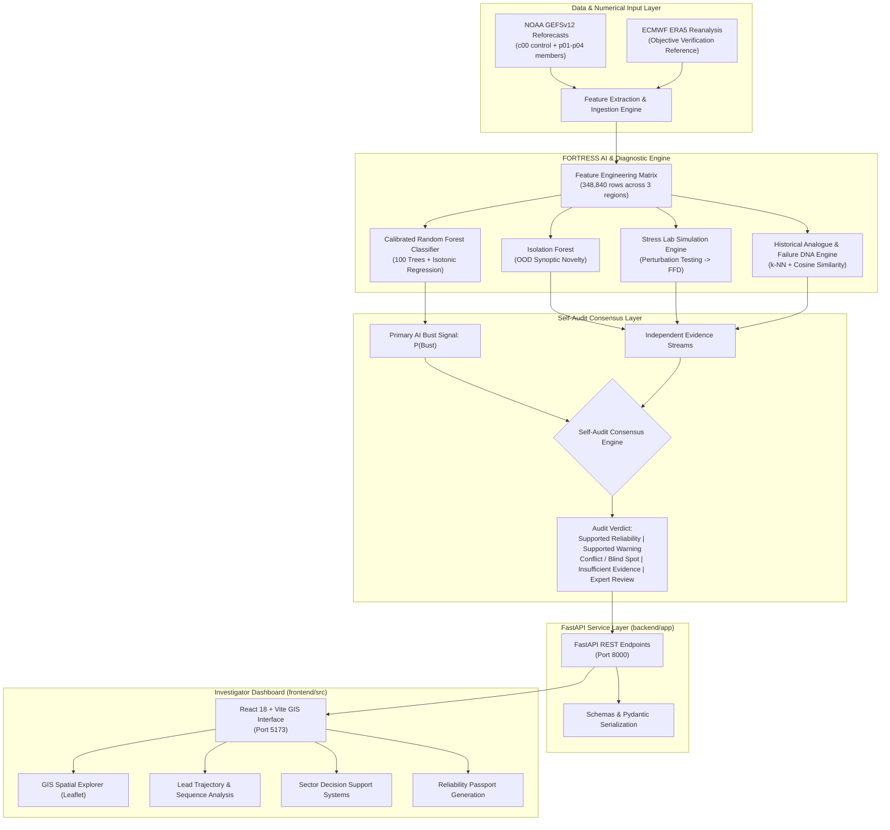

# FORTRESS — Forecast Reliability Stress-Testing & Self-Audit System

> **Operational Distinction**: FORTRESS does not replace operational numerical weather prediction (NWP) or official agency warnings. It estimates **where, when, and how confidently** an existing weather forecast can be trusted for risk-sensitive planning.

[](https://www.python.org/)
[](https://fastapi.tiangolo.com/)
[](https://react.dev/)
[](https://www.typescriptlang.org/)
[](https://vitejs.dev/)
[](LICENSE)

---

## 1. Project Title & Overview

**FORTRESS** (*Forecast Reliability Stress-Testing & Self-Audit System*) is an AI-driven meteorological intelligence and audit layer developed to evaluate the spatial, temporal, and physical trustworthiness of medium-range ensemble weather forecasts.

Medium-range weather forecasts guide multi-million-rupee decisions across dam reservoirs, agricultural harvesting, disaster response pre-positioning, and electrical grid management. However, numerical forecasts occasionally suffer from **severe forecast busts**—catastrophic prediction errors driven by convective instability, non-linear atmospheric chaos, or rapid synoptic evolution. 

FORTRESS audits operational ensemble forecasts (NOAA GEFSv12) against historical atmospheric reanalysis (ERA5), synthesizing machine learning predictions with independent physical evidence to deliver transparent reliability diagnostics.

---

## 2. Problem Statement & Motivation

1. **Uncertainty at Longer Lead Times (D1–D10)**: Raw forecast accuracy deteriorates non-linearly across lead times. Decision-makers often lack objective guidance on whether Day 5 or Day 7 predictions remain actionable.
2. **False Confidence in Ensemble Mean**: A narrow ensemble spread does not guarantee forecast success when all ensemble members share structural model deficiencies in complex topography or monsoon troughs.
3. **Black-Box AI Blind Spots**: Applying standard deep learning or regression to weather forecasts can generate uncalibrated probabilities that fail without explanation during out-of-distribution (OOD) synoptic conditions.
4. **Lack of Multi-Sector Decision Support**: Field operators (dam engineers, agronomists, disaster managers, grid dispatchers) require interpretable risk indices, not raw gigabytes of GRIB2 ensemble grids.

---

## 3. Proposed Solution & Key Differentiators

Rather than generating an alternative weather forecast, FORTRESS introduces a decoupled **meta-forecasting and self-audit architecture**:

* **Estimates Forecast Trust, Not Weather**: Computes calibrated probability of severe forecast error ($P(\text{Bust})$).
* **Decoupled Self-Audit Consensus**: Synthesizes primary AI predictions against four independent physical evidence streams to detect model blind spots.
* **Deterministic Lead-Time Horizons**: Identifies the exact **Trust Horizon** (last actionable lead day) and **Breaking Point** (onset of severe unreliability).
* **Physical Stress Testing (Stress Lab)**: Evaluates forecast fragility by injecting controlled synthetic moisture, thermal, barometric, and kinetic perturbations to measure **Forecast Failure Distance (FFD)**.
* **Domain-Specific Decision Support**: Maps meteorological risk into human-in-the-loop operational advisories for reservoirs, agriculture, disaster relief, and wind energy.

---

## 4. Main Features & User Workflows

| Capability | Module / View | Operational Function |
| :--- | :--- | :--- |
| **Spatial Explorer** | `MapView.tsx` | Interactive 2D Leaflet GIS canvas visualizing $P(\text{Bust})$, Trust Index, FFD, and weather variables across 323 grid points per domain. |
| **Lead Degradation Trajectory** | `TrustHorizonView.tsx` | D1–D10 sequence degradation curves with dynamic **Trust Horizon** and **Breaking Point** indicators. |
| **Stress Testing Laboratory** | `StressLabView.tsx` | Interactive perturbation slider testing model vulnerability across moisture, temperature, pressure, and wind anomalies. |
| **6D Failure Fingerprint** | `FailureIntelligenceView.tsx` | Radar diagnostic characterizing atmospheric failure vulnerability across six physical/ensemble dimensions. |
| **Independent Evidence Audit** | `IndependentEvidenceView.tsx` | Four independent verification streams: Historical Analogues, Failure DNA, Ensemble Disagreement, and OOD Novelty. |
| **Consensus Self-Audit** | `SelfAuditView.tsx` | Evaluator determining if AI signals are corroborated, conflicted, unrepresentative, or requiring expert review. |
| **Reliability Passport** | `PassportView.tsx` | Standardized, exportable one-page diagnostic dossier summarizing audit metrics for operational sign-off. |
| **Multi-Sector Decision Support** | `DecisionSupportView.tsx` | Specialized scenario simulations for Reservoirs/Dams, Agriculture, Disaster Preparedness, and Renewable Grid dispatch. |
| **Multilingual AI Assistant** | `AIAssistantView.tsx` | Context-grounded conversational assistant explaining reliability findings in English, Hindi, and Hinglish. |

---

## 5. System Architecture



---

## 6. End-to-End Data & ML Pipeline

1. **Ingestion**: 5 ensemble members from NOAA GEFSv12 (`c00`, `p01`, `p02`, `p03`, `p04`) and ERA5 surface reference fields are processed for selected meteorological runs.
2. **Feature Engineering**: Calculates ensemble mean, spread, member range, thermal gradients (`temp_2m_c`), moisture content (`specific_humidity_gkg`), barometric pressure (`mslp_hpa`), precipitable water (`pwat_mm`), and surface wind velocities (`u10`, `v10`, `wind_speed_mean_ms`).
3. **Thresholded Bust Labeling**: A forecast state is marked as a *bust* ($Y=1$) when the absolute 24-hour precipitation error exceeds the lead-time-specific 95th historical percentile calculated strictly on the training partition.
4. **Model Training & Calibration**:
   - Base Model: Scikit-Learn `RandomForestClassifier` (100 estimators, max depth 10).
   - Probability Calibration: Non-parametric `IsotonicRegression` fitted on the validation partition to map raw ensemble votes to empirical probabilities.
5. **Decoupled Evidence Generation**:
   - Novelty / OOD: `IsolationForest` scoring deviation from historical synoptic clusters.
   - Analogue Matching: Top-5 nearest historical reforecast states evaluated for retrospective error rates.
   - Failure DNA: Cosine distance against canonical meteorological bust profiles.
6. **Stress Testing**: Perturbation grid ($r \in [0.0, 1.0]$) evaluating minimum atmospheric perturbation distance triggering forecast collapse (**FFD**).

---

## 7. Data Sources, Provenance & Supported Regions

### Supported Meteorological Domains

FORTRESS is validated on three prototype geographic domains:

1. **Eastern Uttar Pradesh (`EASTERN_UP_RECT`)**:
   - Coordinates: $24.50^\circ\text{N} - 28.50^\circ\text{N},\ 80.00^\circ\text{E} - 84.50^\circ\text{E}$
   - Grid Resolution: $0.25^\circ \times 0.25^\circ$ (323 discrete points; $17 \times 19$ grid)
   - Synoptic Focus: Indo-Gangetic monsoon trough, convective storms, flash flooding.
2. **Central India (`CENTRAL_INDIA_RECT`)**:
   - Coordinates: $19.00^\circ\text{N} - 23.00^\circ\text{N},\ 76.00^\circ\text{E} - 80.50^\circ\text{E}$
   - Grid Resolution: $0.25^\circ \times 0.25^\circ$ (323 discrete points; $17 \times 19$ grid)
   - Synoptic Focus: Rainfed agriculture, Narmada/Tapti river basin hydrology, monsoon depressions.
3. **Northwest India (`NORTHWEST_INDIA_RECT`)**:
   - Coordinates: $26.00^\circ\text{N} - 30.00^\circ\text{N},\ 73.00^\circ\text{E} - 77.50^\circ\text{E}$
   - Grid Resolution: $0.25^\circ \times 0.25^\circ$ (323 discrete points; $17 \times 19$ grid)
   - Synoptic Focus: Western Disturbances, canal irrigation networks, semi-arid wind generation.

> **Scope Clarification**: The current prototype dataset covers these three defined regions across 36 selected initialization dates per region (2017–2019). It does not claim continuous pan-India coverage.

### Numerical Data Provenance

* **Ensemble Forecast**: NOAA Global Ensemble Forecast System version 12 (GEFSv12) Reforecast archive initialized at 00Z.
* **Verification Reference**: ECMWF / Copernicus Climate Change Service ERA5 atmospheric reanalysis archive.
  * *Important Scientific Distinction*: ERA5 serves as an objective reference reanalysis dataset for validation; it is not physical ground truth.

---

## 8. Methodology & Model Design

### 6D Failure Fingerprint

Forecast states are mapped onto six normalized dimensions ($0–100$ scale):

1. **Moisture**: Specific humidity anomaly and precipitable water saturation index.
2. **Temperature**: 2m surface thermal gradient and diurnal variance.
3. **Pressure**: Mean sea level barometric anomaly relative to synoptic normals.
4. **Wind**: 10m kinetic vector magnitude and atmospheric shear.
5. **Ensemble Disagreement**: Inter-member spread across `c00`, `p01`–`p04`.
6. **Novelty**: Mahalanobis/Isolation Forest score relative to the training distribution.

### Self-Audit Consensus Framework

| Verdict | Meaning | Recommended Operator Action |
| :--- | :--- | :--- |
| `SUPPORTED RELIABILITY` | Low bust risk confirmed by tight ensemble spread and benign historical analogues. | Proceed with standard operational thresholds. |
| `SUPPORTED WARNING` | Elevated bust risk confirmed by independent physical divergence or high Failure DNA similarity. | Implement risk mitigations; review secondary forecasts. |
| `CONFLICT / POSSIBLE BLIND SPOT` | AI predicts low risk, but independent evidence (e.g., OOD novelty or ensemble spread) is elevated. | Treat forecast with high skepticism; inspect local observations. |
| `INSUFFICIENT EVIDENCE` | Atmospheric regime falls in data-sparse sector where analogues are scarce. | Re-evaluate with next 12Z/00Z NWP cycle. |
| `EXPERT REVIEW` | Contradictory physical indicators or borderline risk scores. | Require senior meteorological review before dispatching advisories. |

---

## 9. Verified Evaluation Metrics & Reproduction

Evaluated across strictly partitioned chronological splits:
* **Train Set**: 2017 to June 1, 2018 (54 initialization dates, 174,420 rows)
* **Validation Set**: July 1 to December 1, 2018 (18 initialization dates, 58,140 rows)
* **Held-out Test Set**: 2019 Unseen Initialization Dates (36 initialization dates, 116,280 rows across all 3 regions)
* **Total Multi-Region Corpus**: 348,840 rows ($174,420 + 58,140 + 116,280 = 348,840$)

### Held-Out Test Set Results (2019 Combined)

| Evaluation Metric | Raw Uncalibrated Model | Calibrated Model (Isotonic) | Verified Benchmark |
| :--- | :---: | :---: | :---: |
| **ROC-AUC** | 0.8567 | **0.8561** | $\ge 0.85$ |
| **PR-AUC** | 0.6408 | **0.6408** | $\ge 0.60$ |
| **Brier Score** | 0.1173 | **0.1178** | $\le 0.15$ |
| **Fixed Threshold Recall (0.50)** | 0.5310 | **0.6077** | $+7.67\%$ gain |
| **Fixed Threshold F1 Score (0.50)** | 0.5893 | **0.6182** | $+2.89\%$ gain |

### Regional Breakdown on Held-Out Test Set (2019)

| Region ID | Domain Name | Test Rows ($N$) | Bust Rate (%) | ROC-AUC | PR-AUC | Brier Score | Mean Trust Horizon |
| :--- | :--- | :---: | :---: | :---: | :---: | :---: | :---: |
| `EASTERN_UP_RECT` | Eastern UP Prototype | 38,760 | 24.16% | 0.8021 | 0.5799 | 0.1415 | 3.75 days |
| `NORTHWEST_INDIA_RECT` | Northwest India Prototype | 38,760 | 11.31% | 0.8792 | 0.5910 | 0.0658 | 5.82 days |
| `CENTRAL_INDIA_RECT` | Central India Prototype | 38,760 | 30.67% | 0.8493 | 0.7068 | 0.1460 | 4.38 days |
| **Combined Held-Out** | **All 3 Regions** | **116,280** | **22.04%** | **0.8561** | **0.6408** | **0.1178** | **4.65 days** |

### Cross-Region Generalization (Leave-One-Region-Out)

| Held-Out Evaluation Domain | Generalization ROC-AUC | PR-AUC |
| :--- | :---: | :---: |
| `CENTRAL_INDIA_RECT` | **0.8502** | 0.6917 |
| `NORTHWEST_INDIA_RECT` | **0.8491** | 0.5807 |
| `EASTERN_UP_RECT` | **0.7877** | 0.5661 |

*Scientific Note on Calibration*: Isotonic calibration maps predicted scores into empirical probability space for interpretability; it does not claim to arbitrarily lower raw Brier score over uncalibrated probabilities.

---

## 10. Reliability Outputs & Definitions

* **$P(\text{Bust})$**: Calibrated probability ($0.0 - 1.0$) of 24h precipitation error exceeding the lead-specific 95th historical percentile.
* **Reliability Bands**:
  * `GREEN` (Reliable): $P(\text{Bust}) < 0.30$.
  * `YELLOW` (Caution / Watch): $0.30 \le P(\text{Bust}) < 0.60$.
  * `RED` (High Bust Risk): $P(\text{Bust}) \ge 0.60$.
* **Trust Horizon**: The highest lead day (D1–D10) up to which the forecast maintains acceptable reliability (`GREEN`/`YELLOW` status).
* **Breaking Point**: The lead day where severe forecast degradation persists without recovery.
* **Forecast Failure Distance (FFD)**: Normalized Euclidean distance ($0.0 - 1.0$) in standardized atmospheric perturbation space required to flip the forecast into a bust. Higher FFD indicates higher physical stability.

---

## 11. Installation & Environment Setup

### Prerequisites

* Python 3.10+ (Python 3.11 recommended)
* Node.js 18+ (Node.js 20+ LTS recommended)
* Git

### Step 1: Clone Repository

```bash
git clone https://github.com/SiyaPahuja-ai/Burst-Forecast-System.git
cd Burst-Forecast-System/FORTRESS
```

### Step 2: Python Environment Setup

#### Windows (PowerShell / Conda):
```powershell
# Using Conda:
conda create -n fortress python=3.11 -y
conda activate fortress

# Or using Python venv:
python -m venv .venv
.\.venv\Scripts\Activate.ps1

# Install requirements
pip install -r requirements.txt
```

#### Linux / macOS:
```bash
python3.11 -m venv .venv
source .venv/bin/activate
pip install -r requirements.txt
```

### Step 3: Frontend Setup

```bash
cd frontend
npm ci
cd ..
```

---

## 12. Backend Startup Instructions

Start the FastAPI backend from the `FORTRESS` project root:

```bash
# Windows / Linux / macOS
python -m uvicorn backend.app.main:app --host 127.0.0.1 --port 8000 --reload
```

* **API Health Check**: `http://127.0.0.1:8000/api/health`
* **Interactive OpenAPI Docs**: `http://127.0.0.1:8000/docs`
* **Swagger Schema**: `http://127.0.0.1:8000/openapi.json`

---

## 13. Frontend Startup & Production Build

### Development Mode

```bash
cd frontend
npm run dev -- --host 127.0.0.1 --port 5173
```

Access the user interface at: **`http://127.0.0.1:5173`**

### Production Build

```bash
cd frontend
npm run build
```

Build outputs are compiled into `frontend/dist/`.

---

## 14. Configuration & Environment Variables

Copy the provided `.env.example` to `.env`:

```bash
cp .env.example .env
```

Default configuration variables:

```ini
# Frontend API Connection URL
VITE_API_URL=http://127.0.0.1:8000/api

# Backend Server Host & Port
HOST=127.0.0.1
PORT=8000
ENVIRONMENT=development
```

---

## 15. Key API Endpoints & Contract Samples

### 1. System Health
* **`GET /api/health`**
```json
{
  "status": "ok",
  "project": "FORTRESS",
  "data_loaded": true,
  "available_forecast_runs": ["2019-07-15 00:00:00", "2019-08-05 00:00:00"]
}
```

### 2. Spatial Grid Map Data
* **`GET /api/map?forecast_init=2019-07-15%2000:00:00&lead_day=5&metric=bust_probability&region=Eastern_UP_Pilot`**
```json
{
  "forecast_init": "2019-07-15 00:00:00",
  "lead_day": 5,
  "metric": "bust_probability",
  "region": "Eastern_UP_Pilot",
  "points": [
    {
      "latitude": 26.75,
      "longitude": 83.37,
      "value": 0.42,
      "reliability_band": "YELLOW",
      "self_audit_status": "SUPPORTED RELIABILITY"
    }
  ]
}
```

### 3. Grid Point Detail & Diagnostics
* **`GET /api/grid-detail?forecast_init=2019-07-15%2000:00:00&lead_day=5&latitude=26.75&longitude=83.37`**
```json
{
  "latitude": 26.75,
  "longitude": 83.37,
  "baseline_p_bust": 0.42,
  "trust_index": 68.5,
  "reliability_band": "YELLOW",
  "ffd": 0.62,
  "trust_horizon_day": 5,
  "breaking_point_day": 7,
  "self_audit_status": "SUPPORTED RELIABILITY"
}
```

### 4. Stress Laboratory Analysis
* **`GET /api/stress-test?forecast_init=2019-07-15%2000:00:00&lead_day=5&latitude=26.75&longitude=83.37`**
```json
{
  "ffd": 0.62,
  "ffd_failure_found": true,
  "fragility_auc": 0.38,
  "fragility_category": "MODERATE",
  "min_bust_delta_humidity": 1.45,
  "min_bust_delta_temp": 1.20,
  "min_bust_delta_mslp": -2.50,
  "min_bust_delta_wind": 3.10
}
```

### 5. Multilingual Explanation Assistant
* **`POST /api/assistant/explain`**
  * Payload:
  ```json
  {
    "message": "D5 forecast me risk kyu badh gaya hai?",
    "language": "auto",
    "forecast_init": "2019-07-15 00:00:00",
    "lead_day": 5,
    "latitude": 26.75,
    "longitude": 83.37
  }
  ```
  * Response:
  ```json
  {
    "answer": "D5 par bust risk 42% hai (YELLOW Band). Primary reason ensemble disagreement me badhotri aur moisture anomaly sensitivity hai.",
    "detected_language": "hinglish",
    "intent": "BUST_RISK"
  }
  ```

---

## 16. Verification, Testing & Quality Assurance

Run the complete verification test suite:

### 1. Backend Unit Tests (38 Tests)
```bash
python -m unittest discover tests
```
*Expected Result*: `Ran 38 tests ... OK`

### 2. Master Release Scientific Invariant Validator (30 Checks)
```bash
python scripts/validate_phase12_final.py
```
*Expected Result*: `SUMMARY: 30 PASSED, 0 FAILED — ALL 30 CHECKS PASSED SUCCESSFULLY!`

### 3. Frontend Typecheck & Production Build
```bash
cd frontend
npm run build
```
*Expected Result*: `✓ built in ~7-10s with 0 errors`

---

## 17. Repository Structure

```
FORTRESS/
├── backend/
│   └── app/
│       ├── main.py
│       ├── data_service.py
│       ├── reservoir_service.py
│       ├── agriculture_service.py
│       ├── disaster_service.py
│       ├── renewable_service.py
│       ├── phase11_service.py
│       ├── assistant_service.py
│       └── schemas.py
├── configs/
│   └── regions.json
├── data/
│   └── processed/
├── docs/
│   ├── figures/
│   ├── final_feature_inventory.md
│   ├── final_judge_qa.md
│   └── final_research_references.md
├── frontend/
│   ├── src/
│   │   ├── components/
│   │   ├── context/
│   │   ├── views/
│   │   ├── lib/api.ts
│   │   └── types/index.ts
│   ├── package.json
│   ├── tsconfig.json
│   └── vite.config.ts
├── models/
│   ├── fortress_bust_model_phase11.pkl
│   ├── fortress_bust_model.pkl
│   └── fortress_ood_model.pkl
├── scripts/
│   ├── train_bust_risk_ai_phase11.py
│   ├── run_stress_lab.py
│   └── validate_phase12_final.py
├── tests/
│   ├── test_agriculture_decision_support.py
│   ├── test_disaster_decision_support.py
│   ├── test_multilingual_assistant.py
│   ├── test_renewable_grid_decision_support.py
│   ├── test_reservoir_decision_support.py
│   └── test_voice_assistant_contract.py
├── .env.example
├── .gitignore
├── requirements.txt
└── README.md
```

---

## 18. Example Workflows & Scientific Figures

Pre-computed evaluation figures and diagnostic distributions are archived in `docs/figures/`:

| Visual Asset | Description |
| :--- | :--- |
| `docs/figures/calibration_curves.png` | Empirical reliability calibration curves demonstrating calibrated probability alignment. |
| `docs/figures/breaking_point_distribution.png` | Lead-time breaking point frequency distribution across tested initialization cases. |
| `docs/figures/leadwise_roc_prevalence.png` | ROC-AUC discrimination and event prevalence across lead times D1 through D10. |
| `docs/figures/region_metric_comparison.png` | Side-by-side metric comparison across Eastern UP, Central India, and Northwest India. |
| `docs/figures/failure_taxonomy_chart.png` | Diagnostic classification of failure clusters in the historical database. |
| `docs/figures/trust_horizon_by_region.png` | Regional distribution of actionable trust horizons. |

---

## 19. Limitations, Assumptions & Future Work

### Limitations & Assumptions

* **Prototype Geospatial Scope**: Calibrated exclusively for 3 geographic domains ($323$ points each); pan-India spatial inference requires additional domain datasets.
* **Initialization Sample**: Evaluated across 36 selected initialization dates per region (2017–2019); not a continuous 3-year multi-decadal climatology.
* **Reference Data**: ERA5 daily precipitation reanalysis serves as verification reference and retrospective labeling source; reanalysis carries intrinsic observation uncertainties.
* **Solar Irradiance Diagnostic**: Solar irradiance forecasting is not implemented in the current prototype; renewable energy decision support is restricted to 10m surface wind reliability.

### Future Work

1. Integration of satellite radar precipitation observations (INSAT-3D/3DR, IMERG) for live real-time observation updates.
2. Expansion of spatial domains to coastal South India and the Northeast Himalayan foothills.
3. Graph Neural Network (GNN) spatial topological message passing across upstream hydrological catchments.

---

## 20. Responsible-Use Disclaimer & Citations

### Operational Safety Disclaimer

> **FORTRESS is a research prototype developed for forecast reliability analysis, stress-testing, and decision-support modeling. It does not issue official meteorological warnings or replace the statutory authority of official forecasting agencies (e.g., IMD / NCMRWF). All decision-support outputs are intended strictly for human-in-the-loop expert review and advisory context. FORTRESS performs no automated physical control or actuation.**

### References & Data Citations

1. **NOAA GEFSv12 Reforecast**:  
   Hamill, T. M., et al. (2022). *The Version 12 Global Ensemble Forecast System (GEFSv12) Reforecast Dataset*. Monthly Weather Review, 150(4), 857-876. [NOAA AWS Registry](https://registry.opendata.aws/noaa-gefs-retrospective/)
2. **ERA5 Reanalysis**:  
   Hersbach, H., et al. (2020). *The ERA5 global reanalysis*. Quarterly Journal of the Royal Meteorological Society, 146(730), 1999-2049. [Copernicus Climate Data Store](https://cds.climate.copernicus.eu/)
3. **Probability Calibration**:  
   Zadrozny, B., & Elkan, C. (2002). *Transforming classifier scores into accurate multiclass probability estimates*. KDD '02.
4. **Scoring Rules**:  
   Gneiting, T., & Raftery, A. E. (2007). *Strictly proper scoring rules, prediction, and estimation*. JASA, 102(477), 359-378.
